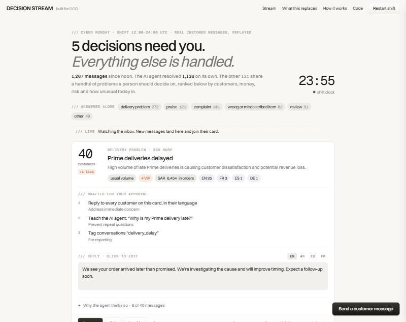
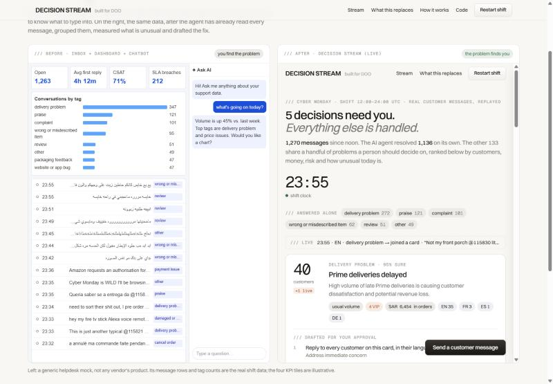

# Decision Stream

**What replaces the dashboard and the chatbot for a CX supervisor?** A screen that has already read every message, found what is spiking, and drafted the fix, so the person only decides.

Built for the *Beyond the Chatbot* builder challenge, around the needs of [DOO](https://www.doo.ooo/) (AI customer-service agents for WhatsApp, Instagram, voice, email and web chat, in the customer's language). Not an official DOO product.

- **Live demo:** _add the Render URL here after the first deploy (see "Deploy")_
- **What this replaces:** `/replaces` (side by side with the inbox + dashboard + chatbot it removes)
- **How it works:** `/how` (architecture snapshot with live numbers, failure paths, thesis)



### What this replaces



## The workflow

A CX supervisor at a marketplace, on the busiest day of the year (a real Cyber Monday). The AI agent already answers the easy messages. What is left for the person today is three screens: an inbox to scroll, a dashboard to interpret, and an "Ask AI" box to type into.

The Decision Stream shows one sentence about what the agent handled alone, then **3–5 decision cards**, ranked by customers × VIPs × money × urgency × how unusual today is. Each card:

- says what is happening, how many customers, how sure the agent is, and how far above normal it is;
- carries actions the agent **drafted on its own** from a closed catalog (reply batch, refund, credit, replacement, ticket, knowledge update for the AI agent), already checked against policy in code;
- has the reply written natively in **English and Arabic** (and in any other language a customer used);
- shows the evidence: the real messages, with their source ids;
- takes one click: **Approve**, **Edit**, **Not this**, or Snooze. Every action has a 30-second undo and a receipt.

Messages keep arriving while you watch (a replay of the real stream), counts tick up, and cards re-rank. Open **Send a customer message** to play the customer in any language: it is classified by the model and routed live, and two similar new complaints make the agent create a new card by itself.

## Architecture: data → intent inference → surfaced decision → action

See [docs/architecture.md](docs/architecture.md) for the full snapshot.

| Stage | Contract (ICM) | Code |
|---|---|---|
| 01 ingest: 3 public datasets → DOO-shaped messages | [stages/01_ingest](stages/01_ingest/CONTEXT.md) | `_tools/build_dataset.py` |
| 02 infer intent: rules, then LLM, 38 intents | [stages/02_infer-intent](stages/02_infer-intent/CONTEXT.md) | `app/pipeline/infer.py` |
| 03 detect patterns: issue vectors, clusters, lift vs baseline | [stages/03_detect-patterns](stages/03_detect-patterns/CONTEXT.md) | `app/pipeline/patterns.py` |
| 04 propose decision: draft + policy gate | [stages/04_propose-decision](stages/04_propose-decision/CONTEXT.md) | `app/pipeline/decide.py`, `app/policy.py` |
| 05 review: the screen | [stages/05_review](stages/05_review/CONTEXT.md) | `app/templates/`, `app/static/` |
| 06 act and learn: execute, undo, corrections | [stages/06_act-and-learn](stages/06_act-and-learn/CONTEXT.md) | `app/act.py`, `app/state.py` |

The workspace follows **ICM** (Interpretable Context Methodology): numbered stage folders, one contract per stage, and the prompts live only in `stages/*/references/`. The runtime reads those same files, so what you read in the repo is what the model is told. Start at [AGENTS.md](AGENTS.md).

**Intent accuracy: 96.1%** on 540 Bitext-labelled messages across 27 intents, with the production classifier and prompt unchanged ([data/eval/report.md](data/eval/report.md)). The model chooses from all 38 intents, so picking one of the 11 real-world extras counts as wrong.

## When it guesses wrong

[docs/failure-test.md](docs/failure-test.md) walks the recovery path; `tests/test_failure_recovery.py` automates it. In short: **Not this** offers the agent's next-best readings, re-drafts, re-labels the messages and feeds the correction into the next inference; the policy gate catches an over-reaching draft before it is shown; low-confidence cards ask a question instead of offering Approve; Undo reverses for 30 s, then becomes a logged compensation.

## Datasets and resources

All customer text is real and public. Nothing is lorem ipsum.

| Resource | Used for | License | Link |
|---|---|---|---|
| **Customer Support on Twitter** (Thought Vector / Kaggle, mirrored on Hugging Face) | English stream: opening tweets to @AmazonHelp. The shift is the real **Cyber Monday 2017** (27 Nov, 12:00–24:00 UTC); the baseline is a sample of the 14 days before | CC BY-NC-SA 4.0 | [Kaggle](https://www.kaggle.com/datasets/thoughtvector/customer-support-on-twitter) · [HF mirror](https://huggingface.co/datasets/SunidhiSriram/twcs) |
| **Arabic Reviews of SHEIN** (Saudi dialects) | Arabic stream: 1–2 star reviews (broken on arrival, sizes run small, wrong colour). Re-timed into the shift because the source has no timestamps | Apache-2.0 | [HF](https://huggingface.co/datasets/Ruqiya/Arabic_Reviews_of_SHEIN) |
| **Bitext customer-support dataset** | Labelled ground truth to measure stage 02 accuracy (20 examples per intent) | CDLA-Sharing-1.0 | [HF](https://huggingface.co/datasets/bitext/Bitext-customer-support-llm-chatbot-training-dataset) |
| DOO public site and Developers Hub | The message schema (inbox, contact, conversation, message) and the product context | — | [doo.ooo](https://www.doo.ooo/) · [developers](https://www.doo.ooo/developers) |
| Navy theme by Lexington Themes | Design tokens (colors, type, spacing, buttons), scraped with Firecrawl | used with permission for this demo | [navy-astro.pages.dev](https://navy-astro.pages.dev/) |
| Switzer (Fontshare), Geist Mono, IBM Plex Sans Arabic (Google Fonts) | Type | free licenses | |
| htmx 2.0.4 | Partial page updates | BSD-2 | [htmx.org](https://htmx.org) |

**Simulated:** customer tiers, orders, refunds, credits, tickets and knowledge entries. No public dataset ships an order system, so each contact gets a deterministic simulated record (`_tools/build_dataset.py: contact_record`). Executing an action computes its exact effect on those records; nothing calls a real payment API.

The raw files are not committed (size and licenses). The processed sample (`data/sample/`), the pipeline outputs (`data/state/`) and the model-response cache (`data/cache/json/`) are, so a clean clone runs without downloading anything or calling a model.

## Run it

```bash
python -m venv .venv && . .venv/bin/activate      # Windows: .venv\Scripts\activate
pip install -r requirements.txt
cp .env.example .env                              # add GROQ_API_KEY and/or GEMINI_API_KEY (free tiers)
uvicorn app.main:app --reload
```

Without keys the stream, approvals, undo and the pre-computed "Not this" re-drafts still work; live classification of new messages needs a key.

Tests:

```bash
pip install -r requirements-dev.txt
python -m pytest -q
```

Rebuild everything from the raw datasets (downloads about 540 MB):

```bash
python _tools/build_dataset.py          # stage 01, needs data/raw/* (links above)
python _tools/run_pipeline.py           # stages 02-04
python _tools/eval_intents.py           # check for stage 02
python _tools/links.py                  # every link and contract input resolves
```

### Deploy (Render free tier)

`render.yaml` is a Blueprint: New → Blueprint → this repo, then set `GROQ_API_KEY` and `GEMINI_API_KEY`. The free tier sleeps after about 15 idle minutes; `.github/workflows/keepalive.yml` pings `/healthz` every 10 minutes once you set the repository variable `RENDER_URL`.

## Notes for reviewers

- **AI tools used:** Claude Code (planning, code, docs), with ICM-architect and parts of ECC (rules, review agents, approval-loop and agent-security patterns) kept local and not committed. At runtime: Groq (`openai/gpt-oss-120b`, `qwen/qwen3.8-27b`, `openai/gpt-oss-20b`) and Google Gemini (`gemini-3.5-flash-lite`, `gemini-2.5-flash`, others in the pool), all free tiers. Clustering uses local TF-IDF vectors over the model's issue phrases, so it needs no embedding API.
- **Key decisions:** FastAPI + Jinja + htmx instead of Gradio, because Gradio's building blocks are chat and dataframe widgets; heavy inference offline, incremental inference live, to fit 512 MB; one sandbox per visitor; money and safety rules in code, not in the prompt; Bitext's 27 intents as the base taxonomy so accuracy is measurable.
- **Out of scope:** real DOO API calls (the webhook accepts DOO's message shape but nothing is sent back), authentication and multi-tenant data, real payments, persistence across restarts (by design for a demo), voice.
- [docs/thesis.md](docs/thesis.md): two-year thesis on post-chatbot interfaces.
